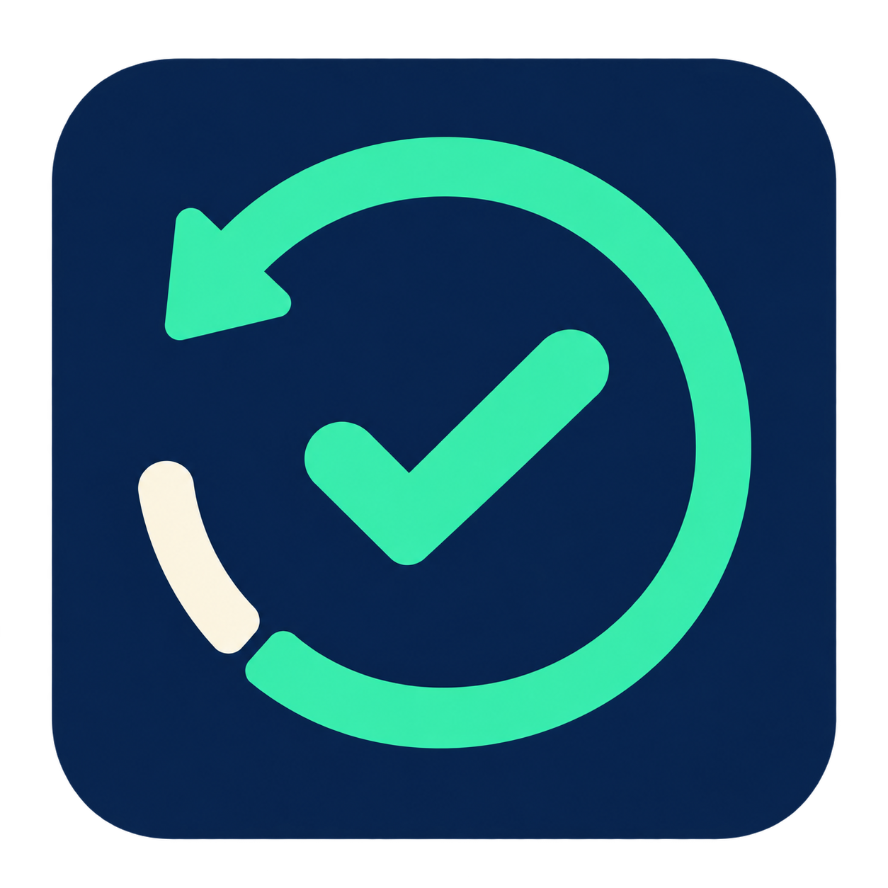
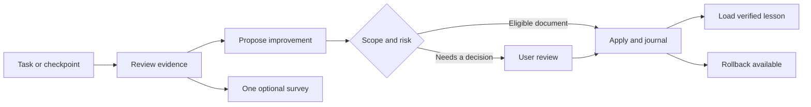

<div align="center">
  
  <h1>After Action Review</h1>
  <p><strong>Review the work. Keep the lesson. Improve the next task.</strong></p>
  <p>A local Codex plugin for evidence-based reviews, reversible improvements, and user feedback.</p>
  <p>
    <a href="https://github.com/dev66613/after-action-review/releases"></a>
    <a href="LICENSE"></a>
    
    
  </p>
  <p><strong>English</strong> · <a href="README.ru.md">Русский</a></p>
  <p><a href="#quick-start">Install</a> · <a href="docs/architecture.md">How it works</a> · <a href="docs/privacy.md">Local data</a> · <a href="https://github.com/dev66613/after-action-review/releases">Downloads</a></p>
</div>

---

After Action Review helps the active agent turn completed tasks, repeated failures,
and real user feedback into verified process lessons. Eligible document changes
are applied within an explicitly owned scope, with a journal, a backup, and a
rollback ID. Serious or disputed changes go to the user for a concrete decision.

The agent performs the review; the plugin collects events and supplies tools.
This is an independent community project.

## What you get

| Capability | Behavior |
| --- | --- |
| Automatic review candidates | Task/goal boundaries, repeated failures, user remarks, and long active sessions |
| Scoped improvements | Evidenced, low-risk document changes in registered owned paths |
| Explainable history | What changed, when, why, the evidence, and a previous file version |
| Guarded rollback | Restore a journaled change without overwriting later user edits |
| Optional feedback | One short survey after a finished or blocked task |
| Bounded execution | One Stop continuation per user turn; no surveys about surveys |

## Quick start

You need **Python 3.11+** and a **Codex execution host supporting plugin hooks**.
On Linux/WSL, both `python` and `python3` must resolve to Python 3.11+ because the
packaged MCP entry point uses `python`. On native Windows, an existing Ubuntu WSL
installation with Python 3.11+ is also required.

```sh
git clone https://github.com/dev66613/after-action-review.git
cd after-action-review
```

**Linux or a WSL Codex executor**

```sh
python3 scripts/install.py --host linux --install
```

**Native Windows Codex** — run from PowerShell, or use the same flag from WSL
when targeting the native Windows host:

```powershell
python scripts/install.py --host windows --install
```

Then open **`/hooks`** in that Codex host, inspect the seven After Action Review
handlers, and trust their current definitions. Start a fresh conversation and
ask the agent to check `aar_status` and its registered scope.

The initial automatic scope is the private `lessons/` directory. Verified lessons
in `lessons/active.md` are loaded at session startup. Register additional
directories only when you own them and want the agent to improve them.
Installation does not grant hook trust.

For an existing installation, prepare a new version directory with
`--destination <new-absolute-path>` and use your host's reviewed update flow.
The installer refuses to overwrite an existing directory. Do not edit installed
caches or assume that an update preserves native hook trust.

See [host compatibility and verified coverage](docs/compatibility.md) for the
Codex manifest workaround, Windows/WSL profiles, and server setup. A standalone
cloud chat needs a separately connected executor or hosted MCP.

## The review loop



Automatic proposals need a registered owned path, an eligible document kind,
low risk, confidence of at least **0.90**, and **two distinct evidence sources**.
Confidence is the agent's assessment, not a measured probability. Default limits
are five applied changes per UTC day and 16 KiB per replacement.

Code, tools, hooks, and configuration go through review under the initial policy.
Structural parsing supplements behavioral evidence. Native sandbox, approvals,
and hook trust remain in force. Read the [architecture](docs/architecture.md)
for transaction and recovery details.

## Ask the agent

> Show the latest AAR and pending decisions.

> Show what changed, when, why, and how to undo it.

> Roll back change `<ID>`.

> Disable surveys. / Pause automatic improvements.

> Add this owned skills directory to the improvement scope: `<absolute path>`.

Russian requests work too; see [the Russian guide](README.ru.md).

## Tools and controls

| MCP tool | Purpose |
| --- | --- |
| `aar_status` | Read pending events, surveys, and scope |
| `aar_review` | Record an evidence-based review |
| `aar_feedback` | Save a real survey reply |
| `aar_propose` | Stage or apply an eligible improvement |
| `aar_changes` | Read the change journal and rollback IDs |
| `aar_apply` | Apply the exact proposal accepted by the user |
| `aar_rollback` | Restore a change with hash guards |
| `aar_recover` | Reconcile interrupted transactions |

From the plugin directory:

```sh
python3 scripts/aar.py doctor
python3 scripts/aar.py changes
python3 scripts/aar.py rollback <ID>
python3 scripts/aar.py recover
python3 scripts/aar.py configure --surveys off
python3 scripts/aar.py configure --automatic off
```

Use `python` on Windows. State and backups live outside the package, on the
Linux/WSL executor, at `~/.local/state/codex-aar` by default. They are protected
with ordinary POSIX permissions, not encryption. Read [local data and privacy](docs/privacy.md).

## Development and releases

The runtime uses the Python standard library. Tests run with isolated temporary
state. In Linux/WSL, from the repository root:

```sh
python3 -m unittest discover -s tests -v
python3 scripts/package.py --output dist
```

Packaging creates Codex-compatible and portable ZIPs, a file inventory, and
SHA-256 checksums. It validates versions, manifests, icon paths, PNG dimensions,
and archive contents. Releases exclude private state, backups, bytecode, and
repository metadata.

See [CONTRIBUTING.md](CONTRIBUTING.md), [CHANGELOG.md](CHANGELOG.md), and
[compatibility](docs/compatibility.md). Report a sanitized reproduction through
[GitHub Issues](https://github.com/dev66613/after-action-review/issues).

## License

[MIT](LICENSE) © 2026 dev66613. The project icon is included under the same license.
