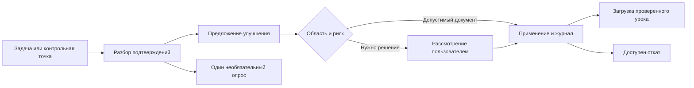

<div align="center">
  
  <h1>After Action Review</h1>
  <p><strong>Разобрать результат. Сохранить урок. Улучшить следующую задачу.</strong></p>
  <p>Локальный плагин Codex: проверенные выводы, обратимые улучшения и обратная связь.</p>
  <p>
    <a href="https://github.com/dev66613/after-action-review/releases"></a>
    <a href="LICENSE"></a>
    
  </p>
  <p><a href="README.md">English</a> · <strong>Русский</strong></p>
  <p><a href="#установка">Установка</a> · <a href="docs/architecture.md">Схема работы</a> · <a href="docs/privacy.md">Локальные данные</a> · <a href="https://github.com/dev66613/after-action-review/releases">Скачать</a></p>
</div>

---

After Action Review помогает агенту разбирать завершённые задачи, повторные
ошибки и замечания пользователя, чтобы улучшать следующий рабочий цикл.
Подтверждённые изменения документов применяются в разрешённой области;
для каждого сохраняются основание, резервная версия и ID отката.
Серьёзные или спорные изменения поступают пользователю на рассмотрение.

Разбор выполняет текущий агент. Плагин собирает события и предоставляет
инструменты. Это самостоятельный проект сообщества.

## Возможности

| Возможность | Что происходит |
| --- | --- |
| Автоматические поводы для AAR | Завершение задачи/goal, повторные сбои, замечания, длинная активная сессия |
| Улучшения в заданной области | Проверенные изменения документов в принадлежащих пользователю каталогах |
| Понятный журнал | Что, когда, почему изменилось; подтверждения и предыдущая версия файла |
| Быстрый откат | Восстановление изменения без перезаписи последующих правок пользователя |
| Необязательная обратная связь | Один короткий опрос после завершённой или заблокированной задачи |
| Ограниченное продолжение | Один дополнительный проход Stop; нет опросов об опросах |

## Установка

Нужны **Python 3.11+** и **Codex с поддержкой plugin hooks**.
В Linux/WSL команды `python` и `python3` должны указывать на Python 3.11+:
упакованный MCP использует `python`. Для штатного Windows Codex также нужен
уже установленный Ubuntu WSL с Python 3.11+. Другой существующий дистрибутив
можно выбрать через `AAR_WSL_DISTRO`.

```sh
git clone https://github.com/dev66613/after-action-review.git
cd after-action-review
```

**Linux или Codex, исполняемый внутри WSL:**

```sh
python3 scripts/install.py --host linux --install
```

**Windows Codex:** в PowerShell, либо из WSL при установке для Windows:

```powershell
python scripts/install.py --host windows --install
```

После установки откройте **`/hooks`** в нужном Codex, проверьте семь обработчиков
After Action Review и подтвердите доверие. Начните новую сессию и попросите
агента проверить `aar_status` и действующую область изменений.

Начальная автоматическая область — личный каталог `lessons/` внутри состояния.
Проверенные уроки из `lessons/active.md` загружаются при старте сессии.
Дополнительные каталоги подключаются по вашему запросу. Установка сама
по себе не подтверждает доверие hooks.

Для уже установленной версии подготовьте новый каталог через
`--destination <новый-абсолютный-путь>` и используйте проверенную процедуру
обновления своего исполнителя. Установщик не перезаписывает существующий
каталог. Не редактируйте установленный кеш вручную; обновление может потребовать
повторной проверки актуальных hooks.

Особенности Windows/WSL, совместимость манифестов и подключение серверов описаны
в [таблице совместимости](docs/compatibility.md). Самостоятельный облачный чат
требует отдельно подключённого исполнителя либо размещённого MCP.

## Как работает цикл



Для автоматического изменения нужны разрешённый путь, допустимый вид документа,
низкий риск, уверенность от **0,90** и **два разных источника подтверждения**.
Уверенность задаёт агент; это не измеренная вероятность. Начальные ограничения:
пять применённых изменений в сутки UTC и 16 КиБ на новую версию файла.

Код, инструменты, hooks и конфигурация в начальной политике требуют рассмотрения.
Структурная проверка дополняет реальные проверки поведения. Разрешения, sandbox
и доверие Codex сохраняют силу. Подробности — в [архитектуре](docs/architecture.md).

## Что можно написать агенту

> Покажи последний AAR и ожидающие решения.

> Покажи журнал: что, когда и почему изменилось, как это откатить.

> Откати изменение `<ID>`.

> Отключи опросы. / Приостанови автоматические улучшения.

> Добавь мой каталог skills в область улучшений: `<абсолютный путь>`.

После завершения или блокировки задачи задаётся один необязательный вопрос:
«Результат и процесс вас устроили?» Ответ сохраняется отдельно от решений
о внедрении изменений. Молчание не считается согласием.

## Инструменты и управление

Восемь MCP-инструментов: `aar_status`, `aar_review`, `aar_feedback`,
`aar_propose`, `aar_changes`, `aar_apply`, `aar_rollback`, `aar_recover`.

Из каталога плагина:

```sh
python3 scripts/aar.py doctor
python3 scripts/aar.py changes
python3 scripts/aar.py rollback <ID>
python3 scripts/aar.py recover
python3 scripts/aar.py configure --surveys off
python3 scripts/aar.py configure --automatic off
```

В Windows используйте `python`. Состояние находится вне пакета, по умолчанию
в `~/.local/state/codex-aar` исполнителя Linux/WSL. Журнал и резервные версии
закрыты обычными правами POSIX; это не шифрование. Подробнее —
[о локальных данных](docs/privacy.md).

## Разработка и релизы

Runtime использует стандартную библиотеку Python. Проверки выполняются
в изолированных временных каталогах. В Linux/WSL, из корня репозитория:

```sh
python3 -m unittest discover -s tests -v
python3 scripts/package.py --output dist
```

Сборка создаёт ZIP для Codex, переносимый ZIP, перечень файлов и SHA-256.
Личные журналы, резервные версии, служебные данные Git и байткод в релизы
не включаются. См. [правила участия](CONTRIBUTING.md),
[историю изменений](CHANGELOG.md) и [проверенное покрытие](docs/compatibility.md).
Об ошибках можно сообщать через
[GitHub Issues](https://github.com/dev66613/after-action-review/issues),
приложив минимальный пример без личных данных.

## Лицензия

[MIT](LICENSE) © 2026 dev66613. Иконка включена под той же лицензией.
