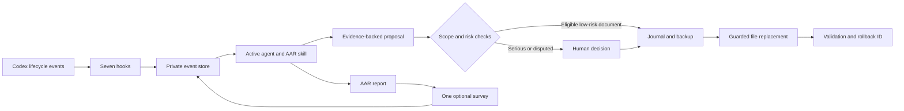

# Architecture

The active Codex agent performs the review. This package supplies bounded event
collection, persistent reports, a scoped change engine, and recovery tools.

| Component | Responsibility |
| --- | --- |
| `hooks/handler.py`, `aar/hooks.py` | Convert native events into bounded candidates and one Stop continuation |
| `aar/runtime.py` | Private state, SQLite reports, deduplication, feedback, and policy |
| `aar/engine.py` | Eligibility, hashes, locking, durable backups, atomic replacement, validation, and rollback |
| `aar/service.py` | Shared CLI/MCP dispatch and argument validation |
| `scripts/windows_bridge.py` | Forward Windows calls into an existing WSL executor |
| `skills/` | Tell the agent when to review, how to gather evidence, and when to ask the user |

Seven hook events are registered: `SessionStart`, `UserPromptSubmit`,
`PostToolUse`, `Stop`, `PreCompact`, `Interrupt`, and `SessionEnd`.
Goal completion or blocking is detected through supported tool events.

Stop uses both the native `stop_hook_active` flag and a durable one-pass budget.
A survey reply and journal write do not create a new user task. Reviews preserve
their original session and turn IDs, acknowledge only relevant events, and leave
unrelated sessions alone.

The initial automatic scope is the `lessons/` directory in private state;
SessionStart loads verified lessons from `lessons/active.md`. Automatic
proposals need an owned registered path, an eligible document kind, low risk,
confidence of at least 0.90, and two distinct sources of evidence. Confidence is
agent-assessed, not a measured probability. The default limits are five applied
changes per UTC day and 16 KiB per replacement.

The engine journals intent and backs up the previous version before replacement.
It uses a POSIX process lock, path checks, file descriptors, and content hashes.
Rollback refuses to overwrite later edits. Recovery reconciles interrupted
transactions and leaves conflicts for review. An external editor racing the
final replacement is not covered by a filesystem compare-and-swap guarantee.

Structural Markdown/JSON/TOML/Python validation supplements behavioral evidence.
It cannot establish that a proposed change is correct. Native approvals and
hook trust remain independent platform controls.
